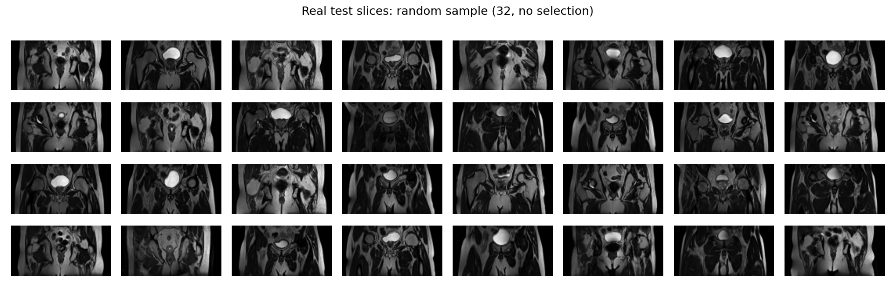
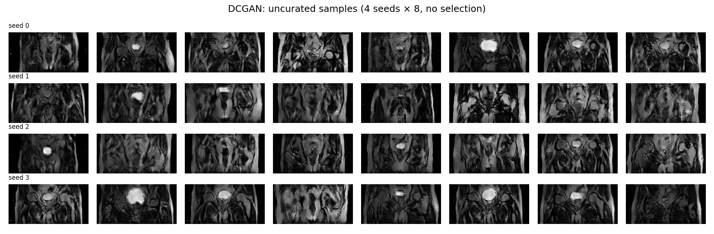
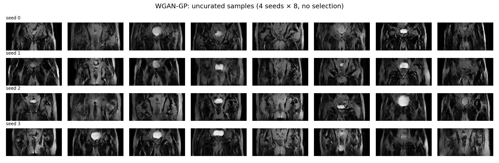
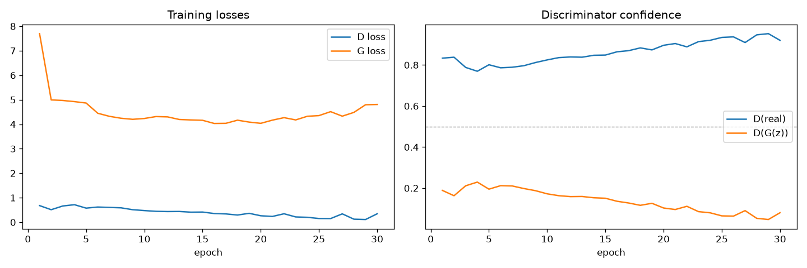
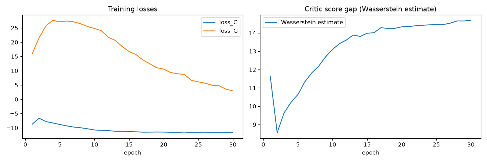
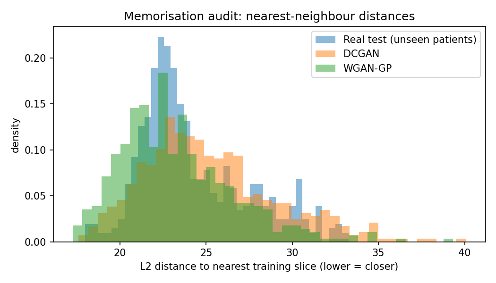
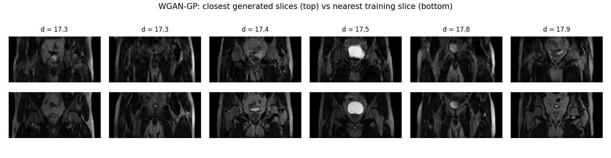
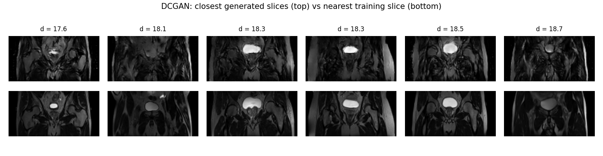
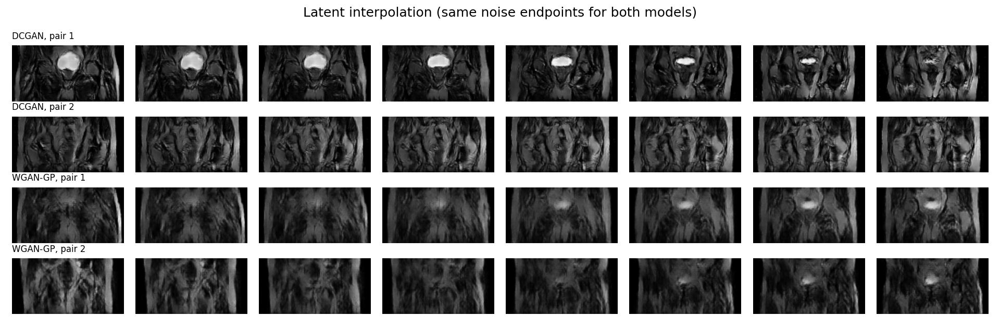
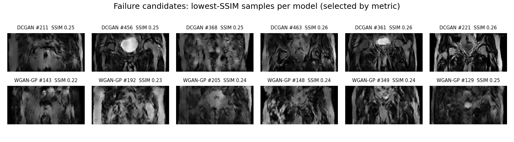

# WGAN-GP vs DCGAN for Synthetic Prostate MRI Generation (HipMRI 2D)

**Author:** Jayden Niddrie (s4889661) · **Course:** COMP3710 Pattern Recognition · **Difficulty:** Normal

## 1. Problem and Algorithm

Medical AI models for prostate MRI, such as organ segmentation or cancer detection, need large training sets. Still, real scans are scarce, expensive to acquire and protected by patient privacy laws. The HipMRI 2D dataset used here contains only 38 patients. This project builds a prototype generative model that produces synthetic 2D pelvic MRI slices (128×64) as a possible supplement for pretraining, method development and data sharing. Synthetic data is useful only if it looks anatomically realistic, and safe to share only if it is genuinely new rather than a copy of a real patient's scan. The project investigates the domain's fidelity, memorisation and privacy dilemma by comparing a DCGAN baseline with a WGAN-GP model, evaluating both on anatomical fidelity, diversity, memorisation of training patients and computational expense.


## 2. How It Works

A generative adversarial network (GAN) trains two networks against each other: a generator turns a 100-dimensional random noise vector into a fake slice, and a discriminator compares slices against real training data; its feedback drives the generator to improve (Goodfellow et al., 2014). Both models share an identical DCGAN-style generator (a 4×2 feature map upsampled by five stride-2 transposed convolutions to a 1×128×64 image, with BatchNorm, ReLU and a tanh output) (Radford et al., 2016), so differences in results come solely from the training objective. The DCGAN baseline's discriminator is a real/fake classifier trained with binary cross-entropy. Once it becomes confident, its output saturates and the generator receives weak gradients, which can cause unstable training and mode collapse. WGAN-GP replaces it with a critic that outputs an unbounded score; the gap between its scores for real and fake images estimates the Wasserstein (earth-mover's) distance, which gives the generator useful gradients even when it is losing (Arjovsky et al., 2017). A gradient penalty keeps the critic smooth by penalising its gradient norm at points blended between real and fake images (Gulrajani et al., 2017). The critic uses LayerNorm instead of BatchNorm, because the penalty requires each image to be scored independently, and it is updated five times per generator step.


## 3. Feasibility Review

COMP3710 (PR) – s4889661 

Feasibility Review

1. User Need, Scope & Acceptance Criteria

Intended user: Medical AI researchers training models for prostate MRI tasks who are limited by scarce, privacy restricted patient scans.

Prototype purpose:  To generate realistic synthetic 2D prostate MRI slices that could supplement real training data and be shared without exposing patients. This addresses the open dilemmas of fidelity vs memorisation vs privacy. Where these synthetic slices are only useful if they look anatomically realistic, and only safe to share if they are not copies of real patients' scans.

Scope: Unconditional 2D slice generation at 128×64 from the HipMRI 2D dataset (no segmentation masks, no 3D volumes).

The 5 Acceptance criteria:
    Fidelity: mean SSIM (similarity structural index measure) > 0.6 between generated slices and their closest real slice. 
    Memorisation / privacy: generated slices are not closer (nearest- neighbour distance) to the training set than real unseen test patients are.
    Diversity: uncurated sample grids across several random seeds show no mode collapse.
    Resource constraint: each model trains in under 2 hours with under 8 GB peak VRAM on a single Colab GPU.
    Baseline comparison: WGAN-GP is compared against the DCGAN baseline on criteria 1–4 using the same data split.

2. Model Choice & Course Concepts

Proposed dataset configuration: We were provided HipMRI 2D slices (keras_slices_data), using the provided patient-level split: train (31 patients) for training only; validate/test (7 unseen patients) as the reference set for the memorisation audit. Slices are scaled per-slice to [-1, 1] and downsampled
from 256×128 to 128×64 (2:1 aspect ratio preserved).

Model architecture (Claude helped me produce architecture):

Generator (Implemented and will be shared by both models): 
- Input: 100-dimensional noise vector
- First Layer turns it into a small 512 channel feature map of size 4×2
- Five “upsampling” layers (transposed convolutions) each double the height and width: 4×2 → 8×4 → 16×8 → 32×16 → 64×32 → 128×64.
- Channels shrink as the image grows: 512 → 256 → 128 → 64 → 32 → 1 (greyscale).
- BatchNorm + ReLU between layers. tanh at the end, so pixel values land in [-1, 1], matching how we scaled the real data.
- 3.20M parameters.
- Status: built, shape and range tested, and used in the smoke test.

Baseline discriminator (DCGAN): Implemented, tested and trained in the smoke test
DCGAN = Deep Convolutional GAN

- Input: a 1x128x64 slice real of fake
- Five strided convolutions each halve height and width: 128×64 → … → 4×2.
- Channels grow: 1 → 32 → 64 → 128 → 256 → 512.
- No normalisation on the first layer, then BatchNorm + LeakyReLU (DCGAN convention).
- A final layer squashes 4×2 into one number: a logit, i.e. “how real does this look”.
- Trained with binary cross-entropy (real = 1, fake = 0).
- 2.79M parameters.
- Status: built, tested, and trained for 2 epochs in the smoke test.

WGAN-GP Critic: (not implemented yet) 
WGAN-GP = Wasserstein GAN with Gradient Penalty
- What’s built: the critic network is the same discriminator class with norm="layer". It swaps BatchNorm for LayerNorm, because the gradient penalty needs each image scored independently. It’s shape-tested (outputs one score per image) and has the same 2.79M parameters.
- What’s not built yet (the WGAN-GP training):
- The Wasserstein loss: the critic tries to push real scores up and fake scores down, with no sigmoid and no probabilities.
- The gradient penalty: the “keep scores smooth” rule.
- The critic loop: training the critic ~5 times per generator update.
- WGAN-GP optimiser settings.

Chosen difficulty band: Normal since DCGAN and WGAN-GP on HipMRI 2D are both normal in the specification.
 
3. Preliminary Feasibility Evidence

Initial data audit: After downloading theHipMRI 2D slices from Rangpur and audited them with shell commands and self test in dataset.py. There was 12,660 slices from 211 scans (60 slices per scan) of 38 patients. The provided split is patient-level (31/4/3 patients), and I verified that no patient appears in more than one split. Slices are 256×128 (one scan is 256×144 and is center-cropped to 256×128).

Baseline smoke-test experiment: I trained a DCGAN baseline for 2 epochs on 256 training slices on my laptop to confirm the full pipeline and confirm it works. The pipeline ran end to end in 6.6 s with finite losses, and checkpoints, sample grids and loss plots were saved. It was observed that the discriminator dominated quickly  (mean D(real) = 0.98, D(fake) = 0.05) which is an early sign of the DCGAN instability that for when we provide our WGAN-GP we expect to fix this instability.

Measured resource estimate: My model self-tests reports 3.20M generator parameters and 2.79M discriminator parameters. The smoke test showed that on epoch on 256 slices about ~0.9 s per epoch on 256 slices. I’m yet to measure peak VRAM or full dataset epoch time.

4. Risks, Budget & Fallback

Training instability: My smoke test showed an early dominating discriminator which can starve the generator of gradients, causing stalled training or mode collapse. To monitor this my training script saves sample grid from the same fixed nose every epoch 
Memorisation: My audit showed only 31 training patients with about 6 scans each, and my data preview showed that neighbouring slices within a scan look almost identical. This repetition makes it easier for a GAN to reproduce real slices, which would defeat the privacy purpose. This will be checked with a nearest-neighbour audit comparing generated slices against real slices from unseen test patients.

Metric ambiguity: A generated slice that is very similar to a training image could reflect good quality or copying, so I will always report SSIM alongside the memorisation audit rather than on its own.

Computing budget: about 2 GPU-hours per model on a single Colab GPU (~4 GPU-hours total, plus short evaluation runs).
The next planned experiment: full DCGAN baseline run on to Colab to measure time per epoch and peak VRAM. I will then implement and train WGAN-GP on the same split.

Workable fallback: lets say WGAN-GP is unstable, I will tune the number of critic steps per generator step, the gradient-penalty weight and the learning rate. And if it underperforms DCGAN, I will report this as a finding with analysis. Both models are normal difficulty so wont affect the mark ceiling 

## 4. Dataset, Pre-processing and Splits

**Dataset.** The HipMRI Study 2D slices (`keras_slices_data`, available on Rangpur at `/home/groups/comp3710/HipMRI_Study_open`) contain 12,660 axial pelvic MRI slices from 211 scans of 38 prostate cancer patients. Every scan has exactly 60 slices, and most patients were scanned at several weekly time points. Only the image folders are used; the segmentation masks are not needed for unconditional generation.

**Pre-processing** (`dataset.py`):
1. Each slice is min-max scaled to [-1, 1] to match the generator's tanh output range. Scaling is per slice because MRI intensities have no fixed physical scale between scans (Nyúl & Udupa, 1999); the trade-off is that absolute brightness differences between scans are lost.
2. Slices are 256×128, except one scan (60 slices) at 256×144, which is centre-cropped to 256×128 so every slice has the same pixel scale.
3. Slices are bilinearly downsampled to 128×64, halving the resolution to reduce training cost while preserving the 2:1 aspect ratio so anatomy is not distorted.

Each full split is cached as a single tensor so training does not re-read around 11,000 files every epoch.

**Splits.** I used the provided train/validate/test split (11,460 / 660 / 540 slices; 31 / 4 / 3 patients). I verified it is patient-level by extracting patient IDs from the filenames, with both a shell comparison and an assertion in `dataset.py`: no patient appears in more than one split.

- **Train** is the only data the GANs see during training.
- **Test** is the "unseen real patients" reference for the fidelity and memorisation evaluation. It shows how close a genuinely new scan naturally sits to the training data, which is only valid because these patients were never seen in training.
- **Validate** is not used for model selection: unconditional GAN training has no held-out loss to tune against, so training was monitored with fixed-noise sample grids and loss curves instead.

**No data augmentation.** Augmentation was deliberately not used. For an unconditional GAN, standard augmentations such as flips, rotations or intensity shifts are learned as part of the data distribution, so the generator would also produce flipped or rotated pelvic anatomy that never occurs in real scans. Avoiding this requires differentiable augmentation applied inside the adversarial loop (Karras et al., 2020), which is noted as future work given the small dataset.


## 5. Dependencies and Reproducibility

| Package | Training (Rangpur A100) | Evaluation (Mac) |
|---|---|---|
| Python | 3.11.16 | 3.12.2 |
| torch | 2.14.0+cu130 | 2.14.0 |
| torchvision | 0.29.0+cu130 | 0.29.0 |
| nibabel | 5.4.2 | 5.4.2 |
| numpy | 2.4.6 | 2.3.1 |
| matplotlib | 3.11.2 | 3.10.3 |

PyTorch 2.14.0 was used on both machines (CUDA 13.0 build on Rangpur); the minor NumPy and Matplotlib differences affect only plotting.

Install: `pip install torch torchvision nibabel numpy matplotlib`

**Reproducibility.**
- All hyperparameters are command-line arguments whose defaults are the values used here (see `train.py`); exact Rangpur job settings are in `slurm/`.
- Random seeds are fixed: 42 for training, 0–3 for sample grids, 1234 for the 512 evaluation samples, 7 for latent interpolation.
- Two independent DCGAN smoke-test runs produced identical losses, confirming the seeding works. Results on other hardware may differ slightly because some GPU operations are non-deterministic.
- Training used a single NVIDIA A100 on Rangpur; smoke tests and evaluation ran on an Apple M-series Mac (MPS/CPU).
- Datasets and trained weights are not included in the repository; `train.py` regenerates the weights from the data.


## 6. Usage

```bash
# Data audit + preview
python dataset.py --root /path/to/keras_slices_data

# Train (local smoke test)
python train.py --root /path/to/keras_slices_data --max-files 256 --epochs 2 --batch-size 32 --run-name dcgan_smoke

# Train (full runs on Rangpur)
mkdir -p slurm/logs
sbatch slurm/train_dcgan.sh
sbatch slurm/train_wgan_gp.sh

# Evaluate both trained generators
python predict.py --root /path/to/keras_slices_data \
    --dcgan runs/dcgan_baseline/generator.pt --wgan runs/wgan_gp/generator.pt
```

`dataset.py` prints the split audit and saves a preview of loaded slices. `train.py` writes `runs/<run-name>/`: per-epoch sample grids, checkpoints, `generator.pt`, `history.json` (metrics, timing and peak VRAM) and `loss_curves.png`. `predict.py` prints the fidelity, memorisation, confound and runtime results and saves every evaluation figure to `figures/`.
## 7. Results

### 7.1 Example inputs and outputs

Real (unseen test patients):


DCGAN (uncurated):


WGAN-GP (uncurated):


All three grids are unselected (fixed seeds, no cherry-picking) and use the same display orientation. Real slices show the bladder top-centre, round femoral heads either side, crisp tissue boundaries and a clean black background. Both GANs reproduce the coarse layout (body outline, bladder, dark background) and generate varied anatomy with no obvious mode collapse, but they fail in different ways:

- **DCGAN** samples are sharper but more chaotic: the bladder is sometimes off-centre or oversized, anatomy is often asymmetric, tissue texture is jagged, and some samples have speckle artefacts in the background.
- **WGAN-GP** samples are more anatomically coherent (bladder consistently top-centre, more left/right symmetry, clean backgrounds) but blurrier and lower in contrast. Its brightest pixel reaches 0.73 versus about 0.9 for DCGAN and real data, so bright structures such as the bladder are under-produced.
- **Neither** model reliably produces the femoral heads.

### 7.2 Training behaviour




**DCGAN:** the discriminator dominated for the whole run. Its mean confidence on real slices rose from 0.83 to 0.95 while its confidence on fakes fell from 0.19 to 0.05, the generator loss rose after about epoch 18, and the discriminator loss spiked at epochs 27 and 30. This is the classic DCGAN failure mode: a saturated discriminator gives the generator weak gradients. Because DCGAN losses do not track image quality, the curves alone cannot show whether samples improved.

**WGAN-GP:** training was smooth, with no spikes, and the gradient penalty stayed steady at 0.18–0.31, showing the critic remained smooth. The Wasserstein estimate dipped to 8.6 at epoch 2, then rose and plateaued at about 14.7. This is ambiguous: the estimate depends on how good the critic is, so it can rise as the critic sharpens even while the generator improves. A plateau may also mean the generator had stopped improving by epoch 30. The absolute value of the WGAN generator loss is arbitrary (critic scores can shift by a constant), so it is not interpreted.

### 7.3 Quantitative benchmarking

512 generated samples per model (seed 1234); reference = 540 real test slices
(3 unseen patients).

| Metric | Real test (reference) | DCGAN | WGAN-GP |
|---|---|---|---|
| Fidelity: best SSIM to 20 nearest train slices (mean ± std) | 0.397 ± 0.035 | 0.363 ± 0.045 | 0.381 ± 0.053 |
| Worst-6 sample SSIM | - | 0.25–0.26 | 0.22–0.25 |
| L2 distance to nearest train slice (median) | 23.28 | 24.59 | 22.68 |
| % samples closer than real 5th pct L2 (expect ~5%) | 5% | 8.8% | 19.1% |
| corr(contrast, L2 distance) | - | +0.74 | +0.65 |
| Max SSIM to a train slice | 0.503 | 0.486 | 0.514 |
| % samples above real 95th pct SSIM (expect ~5%) | 5% | 2.1% | 8.0% |

**Fidelity.** Each generated slice is compared with its most structurally similar training slice (the highest SSIM among its 20 nearest training slices by pixel distance). WGAN-GP reaches 96% of the real-data reference (0.381 vs 0.397), against DCGAN's 91% (0.363). With 512 samples, the standard error of each mean is about 0.002, so the gap is consistent, if modest. However, WGAN-GP has the worse tail: its six worst samples score 0.22–0.25 against DCGAN's 0.25–0.26, corresponding to its larger spread (± 0.053). It is better on average but less reliable.

**The 0.6 SSIM target.** Even real scans of unseen patients only reach 0.397 under this definition, because different patients' anatomy genuinely differs, so no training slice matches a new scan closely. The 0.6 target is not reachable by real data here, so the models are judged relative to the real-data reference rather than the absolute threshold. The specification notes the SSIM target is negotiable.

### 7.4 Resource profiling

| | DCGAN | WGAN-GP |
|---|---|---|
| Generator parameters | 3,197,376 | 3,197,376 |
| Discriminator / critic parameters | 2,791,808 | 2,791,808 |
| Training time per epoch (A100) | 1.9 s | 19.5 s |
| Total training time, 30 epochs | 130.6 s (incl. one-off data cache build) | 660.8 s |
| Peak PyTorch-allocated VRAM | 0.27 GB | 0.34 GB |
| Generation time, 512 slices (Mac CPU, mean of 5) | 0.62 s (1.2 ms/slice) | 0.68 s (1.3 ms/slice) |
| Generation throughput (Mac CPU) | ~820 slices/s | ~750 slices/s |

WGAN-GP was about 10× slower per epoch (19.5 s vs 1.9 s). It updates the critic five times per generator step, and the gradient penalty needs an extra backward pass through the critic. It also used about 25% more peak memory (0.34 vs 0.27 GB), because the penalty keeps an additional computation graph (`create_graph=True`). Both are tiny for an A100 and far inside the 2-hour / 8 GB budget, so compute cost is not a deciding factor at this scale. Peak VRAM is PyTorch's allocated tensor memory (`torch.cuda.max_memory_allocated`), which excludes the CUDA context overhead that `nvidia-smi` would also show. The DCGAN total includes a one-off data-cache build, so per-epoch time is the fair comparison.

Generation cost is effectively identical, because both models share the same generator architecture. Timings are CPU wall-clock and vary between runs: a repeat run measured 0.42 s (DCGAN) and 0.33 s (WGAN-GP) per 512 slices, reversing the order in the table above, which confirms the difference is timing noise. A 512-slice synthetic cohort takes under a second on a laptop CPU, so WGAN-GP's extra cost is paid once, at training time, not at deployment.


### 7.5 Memorisation audit





**Pixel-space (L2) audit.** For each sample, I measured the distance to its nearest training slice and compared it with the same distance for real unseen test slices. A model behaving like genuinely new data should have about 5% of samples closer than the closest 5% of real scans. DCGAN had 8.8%, but WGAN-GP had 19.1%, and its histogram is shifted left of the real reference. Taken at face value, this is a memorisation warning.

**The confound.** The closest WGAN-GP samples are its darkest, blurriest outputs, and their "nearest" training slices are clearly different scans, with crisp bladder, bone and bowel detail the samples lack. L2 distance rewards blur: a smooth, average-looking image sits near many training slices without matching any. Nearest-neighbour distance is highly correlated with sample contrast (r = +0.65 for WGAN-GP, +0.74 for DCGAN), confirming that low-contrast samples score as "close".

**Structural check.** SSIM, unlike L2, penalises blur. No sample is a near-copy: WGAN-GP's maximum SSIM to any training slice is 0.514, against 0.503 for the best-matching real scan, and far below the roughly 0.9+ an actual copy would score. 8.0% of WGAN-GP samples (vs 2.1% for DCGAN) exceed the real 95th-percentile SSIM, a mild excess over the expected 5%.

**Conclusion.** No evidence of memorisation appears in either model. The L2 flag on WGAN-GP is explained by its blur, which shows that pixel-space nearest-neighbour audits must be paired with a structural metric. This was the "metric ambiguity" risk predicted in the feasibility review. One caveat: the reference comes from only 3 test patients (540 slices), so its percentiles are themselves uncertain.

### 7.6 Latent interpolation



Both models interpolate smoothly between random noise vectors, with no abrupt jumps. This suggests a continuous learned space rather than a set of stored images, which supports the memorisation conclusion. Each row also exposed a failure mode the uncurated grids hid:

- **DCGAN pair 1:** the bladder shrinks smoothly, but the final frames dissolve into incoherent texture.
- **DCGAN pair 2:** almost nothing changes across all eight frames. Two different noise vectors give nearly identical slices, a sign of **local mode collapse**.
- **WGAN-GP pair 1:** a bladder appears gradually in the anatomically correct position.
- **WGAN-GP pair 2:** the middle frames lose detail and contrast, regressing to a blurry "average" slice, consistent with the blur found in the audit.

## 8. Failure Case Autopsy



Failure cases were drawn from three sources so they are not hand-picked only for effect: the six lowest-SSIM samples per model (figure above, selected by metric; numbers are sample indices in the seed-1234 draw, so each can be regenerated exactly), the uncurated grids (§7.1) and the latent interpolation (§7.6). Each case is compared against the real test slices.

Notably, WGAN-GP has the worse worst case: its six lowest-SSIM samples score 0.22–0.25, against DCGAN's 0.25–0.26, even though its average is higher. The failures below explain why.

### Case 1: Misplaced organ and global incoherence (DCGAN)
*Evidence:* sample #456; uncurated grid, seed 1, columns 2–3.
- **What happened:** an oversized bladder sits off-centre in a distorted, asymmetric pelvis.
- **Expected:** the bladder top-centre in a left/right-symmetric pelvis, as in every real test slice.
- **Likely cause:** convolutional layers learn local texture well, but nothing explicitly enforces global anatomical layout, and the dominant discriminator (D(G(z)) ≈ 0.05) gave the generator weak, noisy feedback.
- **Model difference:** rarer in WGAN-GP, which places the bladder consistently.

### Case 2: High-frequency artefacts and background speckle (DCGAN)
*Evidence:* samples #221, #368; uncurated grid, seeds 0 and 2, column 1.
- **What happened:** striated "wood-grain" or chaotic tissue texture, and bright speckle dots in what should be an empty black background.
- **Expected:** smooth tissue regions and a clean background.
- **Likely cause:** transposed convolutions are prone to high-frequency and checkerboard artefacts; unstable adversarial training (discriminator loss spikes at epochs 27 and 30) did not suppress them.
- **Model difference:** WGAN-GP backgrounds are clean.

### Case 3: Local mode collapse (DCGAN)
*Evidence:* latent interpolation, DCGAN pair 2.
- **What happened:** two different random noise vectors produced nearly identical slices across all eight interpolation steps.
- **Expected:** different noise vectors should produce different anatomy.
- **Likely cause:** a generator under constant pressure from a dominant discriminator tends to fall back on "safe" outputs that ignore the noise in parts of the latent space.
- **Why it matters:** the uncurated grids looked diverse, so this collapse was only visible through interpolation. Diversity can be overestimated from sample grids alone.

### Case 4: Blur and washed-out "average" slices (WGAN-GP)
*Evidence:* samples #205, #192, #129; interpolation, WGAN-GP pair 2, middle frames.
- **What happened:** flat grey, low-contrast slices with no crisp organ boundaries; #192 also shows vertical streak artefacts.
- **Expected:** crisp tissue boundaries and a bright bladder. Real slices reach an intensity of about 0.94, while WGAN-GP's maximum is 0.73.
- **Likely cause:** the generator hedges toward the average intensity of the data. The run is also likely under-trained: 30 epochs, with the Wasserstein estimate still plateauing.
- **Why it matters:** this blur is exactly what made the L2 memorisation audit misleadingly flag WGAN-GP (closeness correlated with low contrast, r = +0.65).

### Case 5: Missing fine anatomy (both models)
*Evidence:* uncurated grids for both models, compared with the real test grid.
- **What happened:** the femoral heads (round hip joints) and fine midline structures are absent or vague in almost all samples.
- **Expected:** clear round femoral heads either side of the bladder, as in nearly every real slice.
- **Likely cause:** small, sharp, round structures are hard to learn at 128×64 in 30 epochs; both models capture the coarse layout (body outline, bladder) before fine detail.
- **Why it matters:** researchers using these slices would get images missing key bony landmarks. This is a clinical plausibility failure that the SSIM numbers do not capture.

### Operational summary
DCGAN fails through **instability**: misplaced organs, high-frequency artefacts and local collapse. WGAN-GP fails through **blur**: low-contrast, detail-poor slices. No single metric caught every failure. SSIM missed the missing femoral heads, the uncurated grids hid DCGAN's local collapse, and the L2 audit mistook WGAN-GP's blur for memorisation. Any synthetic cohort from either model would need quality filtering of the low-SSIM tail and visual review before release.

## 9. Acceptance Criteria Outcome

| Criterion (from feasibility review) | Outcome |
|---|---|
| 1. Fidelity: SSIM > 0.6 to closest real slice | **Not met as defined; criterion miscalibrated.** Even real unseen scans only reach 0.397, so 0.6 is unreachable under this definition. Relative to the real reference, WGAN-GP reaches 96% (0.381) and DCGAN 91% (0.363). |
| 2. Memorisation / privacy | **Met.** No near-copies: max SSIM to any training slice is 0.514 (WGAN-GP) and 0.486 (DCGAN), vs 0.503 for real scans. The L2 flag on WGAN-GP (19.1%) is explained by blur (r = +0.65). Mild SSIM excess for WGAN-GP (8.0% vs ~5% expected). Caveat: reference from only 3 patients. |
| 3. Diversity: no mode collapse | **Partially met.** No global collapse in the uncurated grids for either model, but DCGAN shows local mode collapse in latent interpolation (pair 2). |
| 4. Resource: < 2 h, < 8 GB VRAM | **Met.** 130.6 s / 0.27 GB (DCGAN) and 660.8 s / 0.34 GB (WGAN-GP) on an A100. |
| 5. Baseline comparison on the same split | **Met.** Both models evaluated on the same 512-sample protocol against the same train/test splits. |

## 10. Engineering Recommendation

**Verdict: neither synthetic cohort is ready to share without screening,
but WGAN-GP is the better foundation for continued development.**

**Recommended model: WGAN-GP.** It produced more anatomically coherent
slices (consistent bladder placement, more symmetry, clean backgrounds),
came closer to real-data fidelity on average (96% vs 91% of the real SSIM
reference), trained stably without the discriminator dominance and loss
spikes seen in DCGAN, and showed no evidence of memorising training
patients. Its extra cost is justified at this scale: training was about
10× slower per epoch, but that is 11 minutes versus 2 on one GPU, and
generation cost is identical (under a second per 512 slices on a laptop
CPU).

**Why not ready yet.** WGAN-GP's main weakness is blur. Its samples are
lower in contrast than real scans, it has a worse tail than DCGAN (lowest
SSIM 0.22), and neither model reliably produces the femoral heads. A
cohort released as-is would contain detail-poor and anatomically
incomplete slices that could teach downstream models misleading features.

**Required before any release:**
1. **Quality gate.** Automatically discard samples below a fidelity
   threshold calibrated on real data (e.g. below the real 5th-percentile
   SSIM), then visually review the remainder.
2. **A stronger privacy audit.** Use structural (SSIM) and feature-based
   similarity rather than pixel (L2) distance alone, against a larger
   reference set than the current 3 test patients (e.g. validate + test,
   7 patients).
3. **More training and capacity.** Train longer (the Wasserstein estimate
   had not clearly converged at 30 epochs) and at higher resolution, to
   recover contrast and fine anatomy such as the femoral heads.
4. **A downstream utility test.** Check whether adding synthetic slices
   actually improves a real task, such as pretraining a model later
   fine-tuned on real labelled data.
5. **Expert review.** Have a clinician or MR physicist assess anatomical
   plausibility before any external use.

**Appropriate use now:** internal prototyping only, such as testing data
pipelines or exploratory pretraining experiments. **Not appropriate:**
clinical or diagnostic use, external data sharing, or training supervised
segmentation models (the generator produces no masks).

## 11. Limitations and Future Work

**Limitations**
- **Unconditional generation:** the generator produces images only, with no segmentation masks or labels, so the synthetic slices cannot directly train supervised models such as prostate segmentation.
- **Resolution and training length:** 128×64 (half native resolution) and 30 epochs per model. Fine structures such as the femoral heads were not learned, and the WGAN-GP Wasserstein estimate had not clearly converged.
- **Single run per model:** each model was trained once (seed 42), so run-to-run variation is not measured.
- **Small reference set:** the real-data reference for the fidelity and memorisation evaluation comes from only 3 test patients (540 slices), so its percentiles are uncertain.
- **Metric limitations:** SSIM to the nearest training slice is capped at about 0.40 even for real scans, and pixel (L2) distance is confounded by blur. Neither captures anatomical plausibility (e.g. missing femoral heads), which was judged visually.
- **No distributional metric:** FID or a feature-based coverage measure was not computed.
- **2D only:** slices are generated independently, so there is no consistency between neighbouring slices of a volume.

**Future work**
- Train longer and at full 256×128 resolution; repeat with several seeds.
- Add a feature-based memorisation audit and a distributional metric (e.g. FID with a medical-imaging feature extractor), using validate + test (7 patients) as the reference.
- Generate image–mask pairs with a conditional GAN, so synthetic data can train segmentation models, and test downstream utility directly.
- Explore architectures with stronger global structure, such as StyleGAN2, which my tutor suggested as a Hard-difficulty extension.

## 12. References

Arjovsky, M., Chintala, S., & Bottou, L. (2017). Wasserstein generative adversarial networks. In *Proceedings of the 34th International Conference on Machine Learning* (Vol. 70, pp. 214–223). PMLR. https://proceedings.mlr.press/v70/arjovsky17a.html

Goodfellow, I., Pouget-Abadie, J., Mirza, M., Xu, B., Warde-Farley, D., Ozair, S., Courville, A., & Bengio, Y. (2014). Generative adversarial nets. In *Advances in Neural Information Processing Systems* (Vol. 27, pp. 2672–2680). Curran Associates. https://arxiv.org/abs/1406.2661

Gulrajani, I., Ahmed, F., Arjovsky, M., Dumoulin, V., & Courville, A. (2017). Improved training of Wasserstein GANs. In *Advances in Neural Information Processing Systems* (Vol. 30, pp. 5767–5777). Curran Associates. https://arxiv.org/abs/1704.00028

Karras, T., Aittala, M., Hellsten, J., Laine, S., Lehtinen, J., & Aila, T. (2020). Training generative adversarial networks with limited data. In *Advances in Neural Information Processing Systems* (Vol. 33, pp. 12104–12114). Curran Associates. https://arxiv.org/abs/2006.06676

Nyúl, L. G., & Udupa, J. K. (1999). On standardizing the MR image intensity scale. *Magnetic Resonance in Medicine, 42*(6), 1072–1081. https://onlinelibrary.wiley.com/doi/10.1002/(SICI)1522-2594(199912)42:6%3C1072::AID-MRM11%3E3.0.CO;2-M

Radford, A., Metz, L., & Chintala, S. (2016). Unsupervised representation learning with deep convolutional generative adversarial networks. In *International Conference on Learning Representations*. https://arxiv.org/abs/1511.06434

Wang, Z., Bovik, A. C., Sheikh, H. R., & Simoncelli, E. P. (2004). Image quality assessment: From error visibility to structural similarity. *IEEE Transactions on Image Processing, 13*(4), 600–612. https://ieeexplore.ieee.org/document/1284395

## 13. Artificial Intelligence Usage Disclosure

**Tool used:** Claude (Anthropic, via claude.ai), which I used throughout the project as a tutor and coding assistant.

**What I used AI for:**
- **Planning:** I pasted the assessment specification into Claude and used it to make sure I understood the whole task: the requirements, marking, hurdles and project options. It helped me choose the project and build a master plan of small milestones, so I could develop the project step by step with a clean commit history.
- **Code:** I asked Claude to set up the skeleton of each file first (`dataset.py`, `modules.py`, `train.py`, `predict.py`), then give me the code in small blocks. For each block I added it, ran its test and committed it before moving on, rather than copying in a whole finished file. This included building the DCGAN and WGAN-GP models, the training loop, the Slurm scripts and the evaluation.
- **Understanding:** I asked Claude to explain every part of the code and the ideas behind it (how GANs work, the difference between DCGAN and WGAN-GP, the Wasserstein loss, the gradient penalty and SSIM) until I could explain them in my own words.
- **Debugging:** when something broke, such as a missing import, a function not returning a value, a job accidentally running on the Rangpur login node, or editing the shared README instead of mine, I pasted the error into Claude and worked through the fix.
- **Writing:** Claude helped me work out exactly what the README and feasibility review needed to contain, provided a skeleton and drafts, and I rewrote them in my own words. I also used Grammarly to proofread the final README.

**How I checked the AI's work:**
- **Data:** I audited the dataset myself with shell commands (counting slices, scans and patients, and checking no patient appeared in more than one split) before trusting the loader, which also checks this with an assertion. I visually checked a preview of the loaded slices.
- **Models:** every block came with a test that I ran (output shapes, value ranges, gradients reaching the generator, parameter counts), and I went through the model code with Claude until I understood each layer.
- **Training:** I smoke-tested both models locally on a small subset before every full run. Two identical smoke runs confirmed the seeding makes results reproducible, and I checked the full runs actually used the GPU.
- **Metrics:** I ran a self-test of the SSIM function (an image compared with itself scores 1.0, random noise about 0.05). Every number in this README comes from my own run outputs.
- **Results:** I looked at every figure myself and didn't just accept the first result. The first memorisation check suggested WGAN-GP was copying training images, but the samples it flagged looked nothing like their matches, so I added extra checks, which showed the result was caused by blur, not copying.

**Where the AI's output needed correcting:**
- Some shell commands it gave me included `#` comments, which broke when pasted into my terminal (zsh), so I re-ran them without the comments.
- Its first fidelity measure compared each sample with only one nearest training slice. We refined it to the best match among the 20 nearest.
- An early claim that WGAN-GP trained about 5× slower was corrected to about 10× per epoch once the full-run timings were compared fairly.
- An early draft of my feasibility review said I had hand-calculated the parameter counts, which I hadn't, so I removed it.